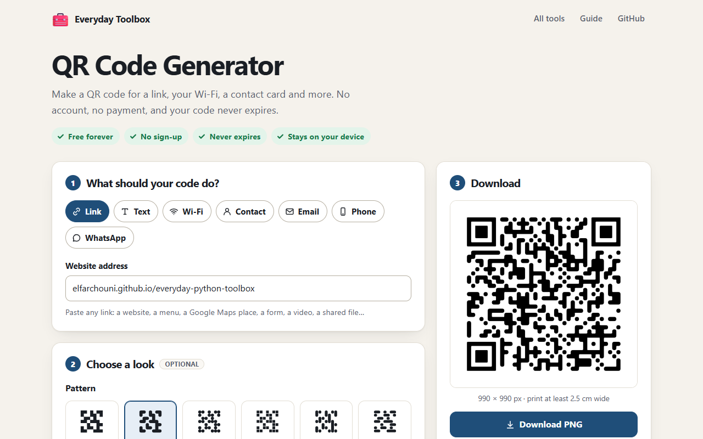
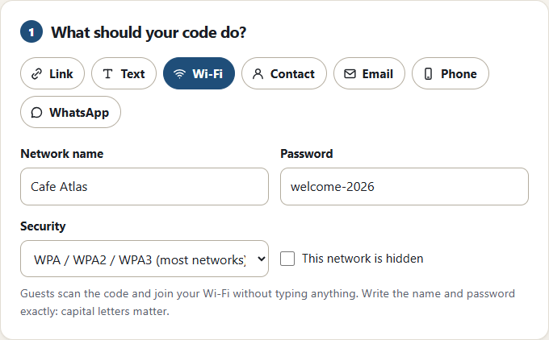
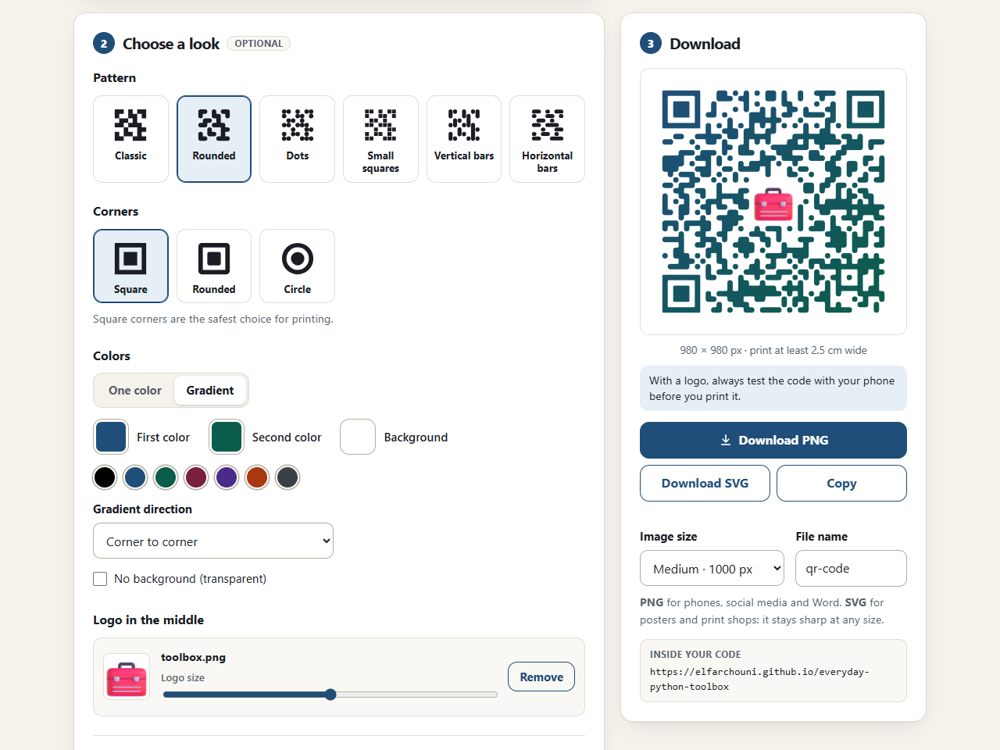
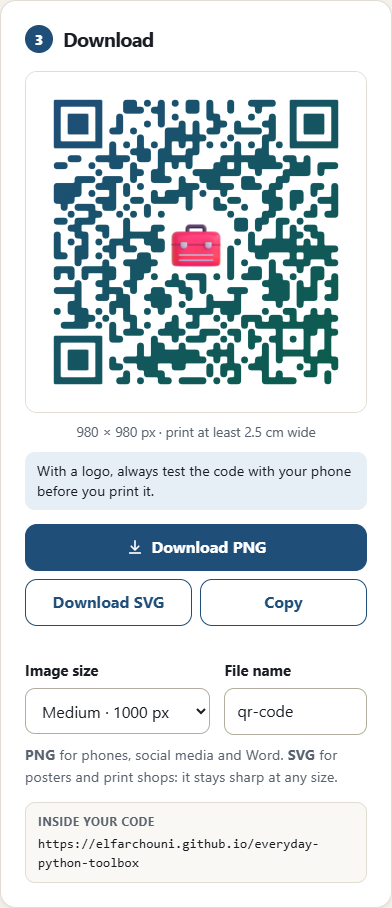
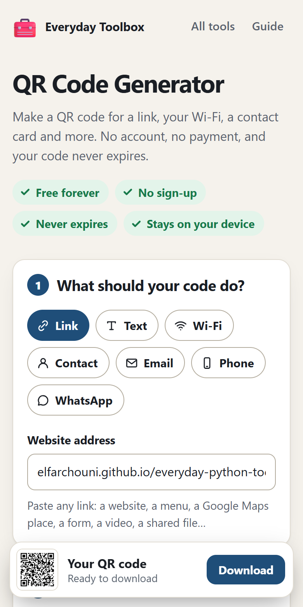

# QR Code Generator 🔳

Make QR codes for a link, your Wi-Fi, a contact card, WhatsApp and more,
in your colors, with your logo.

**Your codes never expire.** No account, no payment, no limit on scans.

There are two ways to use it:

| | For whom | How |
|---|---|---|
| 🌐 **Web app** | Everyone. Nothing to install, works on a phone | Open **<https://elfarchouni.github.io/everyday-python-toolbox/qr/>** |
| 🐍 **Python script** | People who code | `python qr_codes/qr_generator.py` |

---

## Guide to the web app



The page has three numbered steps. The preview on the right updates while you
type, so you always see the code you are going to get.

### Step 1: Say what the code should do

Pick a type at the top, then fill in the boxes.

| Type | What happens when someone scans it | Good for |
|---|---|---|
| **Link** | Opens a web page | Website, menu, Google Maps place, form, video, shared file |
| **Text** | Shows a short message (works without internet) | A note, a code, instructions |
| **Wi-Fi** | Joins your network without typing the password | Home, café, office, guest house |
| **Contact** | Offers to save you as a new contact | Business cards, name badges |
| **Email** | Opens a new email to you, already addressed | "Write to us" on a flyer |
| **Phone** | Dials your number | "Call us" on a poster or a van |
| **WhatsApp** | Opens a chat with you, with a message already written if you like | Orders, bookings, support |



Good to know:

- For a **link**, you can paste the address as it is. If you forget `https://`
  it is added for you.
- For **Wi-Fi**, type the network name and the password *exactly*: capital
  letters matter.
- For **Phone** and **WhatsApp**, start with the country code, like
  `+212 6 12 34 56 78`. Without it the number may not work.
- If something looks wrong (a space in a link, a password that is too short…)
  a yellow tip appears under the boxes.

### Step 2: Choose a look (optional)

You can skip this step. The default look scans perfectly.



- **Pattern**: the shape of the small squares (Classic, Rounded, Dots, Small
  squares, Vertical bars, Horizontal bars).
- **Corners**: the three big squares in the corners. *Square* is the safest
  choice for printing. *Circle* looks great and works with phone cameras, but
  some older scanner apps cannot read it.
- **Colors**: one color or a gradient, plus the background color. Click a
  colored circle for a quick choice, or the color box to pick any color.
  Keep the code **dark** and the background **light**.
- **Logo in the middle**: choose an image (PNG, JPG or SVG) or drop it on the
  box. Use the slider to make it bigger or smaller. A simple logo works best.
- **More options**: the white margin around the code, and how much damage the
  code can survive. The standard values are good for almost everyone.

If a choice could make the code hard to scan (colors too close, a light code
on a dark background, too much text), a warning appears under the preview.

### Step 3: Download, then test



- **Download PNG**: a normal picture. Use it for phones, social media, Word
  and PowerPoint.
- **Download SVG**: a picture that stays sharp at any size. Use it for
  posters, banners and print shops.
- **Copy**: copies the picture so you can paste it straight into a document
  or a chat.
- **Image size**: how big the PNG is. *Medium* is fine for screens; choose
  *Print* for paper.
- **File name**: the name of the downloaded file.
- **Inside your code**: shows exactly what the code contains. What you see
  there is all there is: no hidden redirect, nothing that can be switched off.

**Always test before you print:** open your phone's camera, point it at the
code on your screen, and check that it opens the right thing.

### On a phone



Everything works the same. While you scroll, a small bar at the bottom shows
your code; tap **Download** to jump to it.

### Checklist before you print

- [ ] Tested with two different phones
- [ ] Dark code on a light background
- [ ] White margin kept around the code
- [ ] At least 2 cm wide. For a poster, about one tenth of the distance
      people will scan it from
- [ ] SVG file used for anything large
- [ ] Square corners, if the code must work with *every* scanner

### Questions

**Will my code stop working one day?**
No. Your link or text is written directly into the picture. Nothing depends on
this website: once you have downloaded the code it works forever.

**Why do some websites ask for money after a few days?**
Many "free" generators make *dynamic* codes. The code does not contain your
link. It contains a link to *their* server, which forwards people to you.
When the free trial ends they switch the forwarding off and ask for a
subscription, often after you have already printed the code. This tool only
makes *static* codes, with nothing in the middle.

**Can I change where the code goes after I print it?**
No. That is the one thing a static code cannot do. Make a new code, or point
the code at a page you control and change that page instead.

**Where does my information go?**
Nowhere. The code is made on your own phone or computer. What you type and the
logo you add are never uploaded. There is no account, no tracking, no ads.

**My code does not scan.**
Try these in order: a dark color on a white background; Square corners with
the Classic or Rounded pattern; a smaller logo, or none; shorter content; a
larger print.

---

## Using the Python script

The same idea in the terminal: the script asks you a few questions, then saves
the code.

```bash
pip install "qrcode[pil]"
python qr_codes/qr_generator.py
```

It asks for the content, error correction, module shape, eye shape, colors
(solid or gradient), an optional logo, resolution, border, format and file
name. Files are saved in `qr_codes/Generated_QR_Codes/`.

| | Web app | Python script |
|---|---|---|
| Install | Nothing | Python + `qrcode[pil]` |
| Wi-Fi / contact / WhatsApp helpers | Yes | Type the content yourself |
| Styled SVG (shapes, colors, logo) | Yes | SVG is classic black and white |
| Live preview and scan warnings | Yes | No |
| Works without a browser, scriptable | No | Yes |

---

## How it works

- The web app is plain HTML, CSS and JavaScript in [`docs/qr/`](../docs/qr/):
  no framework, no build step, no server. GitHub Pages serves the files as
  they are.
- [`qr-render.js`](../docs/qr/qr-render.js) turns text into a styled code
  (SVG and PNG are drawn from the same outline, so they always match).
  [`qr-app.js`](../docs/qr/qr-app.js) handles the form and the downloads.
- The QR encoding itself uses
  [qrcode-generator](https://github.com/kazuhikoarase/qrcode-generator) by
  Kazuhiko Arase (MIT license), included in `docs/qr/vendor/` so the page
  never loads anything from another website.
- The shapes were tuned with scan tests: every pattern was blurred, tilted and
  shrunk like a phone photo, then read back with five different decoders.
